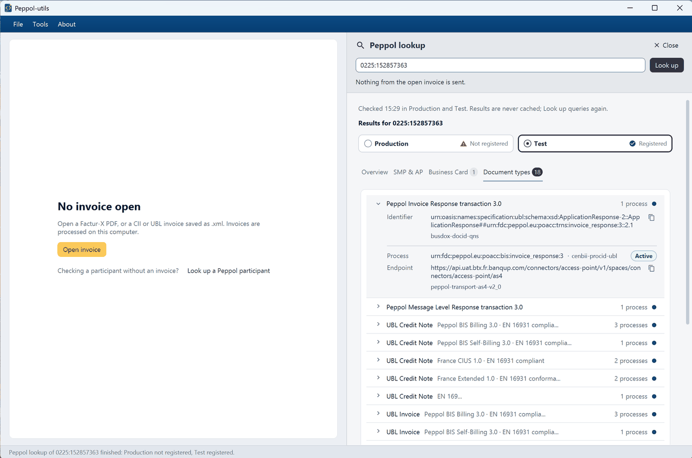

# Peppol-utils 1.9.9 User Guide

Peppol-utils opens an electronic invoice on your computer. You can read it, edit its XML, validate it, convert it between UBL and CII, save it, and look up the buyer's or seller's Peppol registration.

It opens a **Factur-X PDF** (a PDF that carries the invoice XML) or a standalone **`.xml`** invoice in CII or UBL syntax.

## Install

Download the files from the [latest release](https://github.com/Duclevn/Peppol-utils-release/releases/latest).

- **Windows:** run `Peppol-utils-<version>-windows-x64-setup.exe`, then start Peppol-utils from the Start menu. No Java is needed.
- **Any system:** use `peppol-utils-<version>.jar` with Java 25 or newer: `java -jar peppol-utils-<version>.jar`. It runs on Windows x64, Linux x64/ARM64 and macOS Intel/Apple Silicon.

## Open an invoice

Click `Open invoice`, choose `File` > `Open...`, or press `Ctrl+O`. In Windows you can also right-click a `.pdf` or `.xml` file and choose `Open with` > `Peppol-utils`.

Opening an invoice never validates it and never uses the network.

## The window

Choose **Tools > Appearance > Dark** or **Light**. Light is the default. The sun or moon button at the right end of the top bar does the same: in Dark it shows a sun and switches to Light, in Light it shows a moon and switches to Dark. The window changes immediately and remembers your choice the next time you open Peppol-utils. PDF pages and **Visualize from XML** keep their white paper. Windows High Contrast takes precedence while it is on and your chosen appearance returns when you turn it off.

The row at the top shows your file, its format, `Saved` or `Unsaved`, and the `Convert` and `Validate` buttons. Each file you create with `Convert` is a tab in that row after your file, with a dot while it is unsaved and a `×` to close it. Under the row are two cards, and a third column when the Peppol lookup is open:

- `Overview`: invoice number, type, date, amounts, seller, buyer, and the detected format, profile and validation rules (VESID).
- `Document`: has tabs `Original PDF` (a Factur-X file only), `XML` and `Visualize from XML`. A standalone XML opens on `Visualize from XML`. The PDF and the rendering show all pages in one column: scroll through them, and the arrows jump to the previous or next page. The zoom (`−`, percentage, `+`) is at the right of the tab row; above 100% the page grows past the card and scrolls sideways. On the `XML` tab the same row holds `Pretty print`, `Copy` (the whole XML), Find and the text size of the XML. When the card is narrow, the page controls fold into `⋯` (`More page controls` for the PDF; for the rendering it also holds `Render again` and `Save PDF as…`). The `XML` tab's controls fold the same way into `More XML tools`: Find and Replace first, then the text size.

## The XML tab

`Visualize from XML` draws the invoice from its XML as a readable PDF: header, seller and buyer, invoice lines, VAT breakdown, totals and payment details (with a payment QR code when the XML has a bank account). Labels and country names are in English, and dates read like `19 Aug 2025`. Characters outside the Latin, Greek and Cyrillic scripts, such as Japanese or Arabic, show as `?` in the rendering; the XML itself is unchanged.

The `XML` tab of the Document card holds the invoice XML. Edit it directly, indent it with `Pretty print`, search with `Ctrl+F`, or copy it all with `Copy`. `Ctrl+H`, or the arrow to the left of the search field, adds a `Replace` field: `Replace` changes the selected match and moves to the next one (the first press only selects the next match), and `Replace all` changes every match at once, so one `Ctrl+Z` undoes it. Searching ignores upper and lower case, and the replacement is put in exactly as typed. The Replace controls are off while the XML cannot be edited. Edits stay unsaved until you save (see below), and `Visualize from XML` shows how your edits render.

## Validate

Click `Validate`, or press `F5`. Its arrow picks the rule set:

- `Auto`: the rules that the invoice declares for its syntax and profile, for example EN 16931, Factur-X, XRechnung or Peppol BIS. France PPF Flux 1 and Flux 10 documents are checked here too.
- `France CTC`: the `Auto` rules plus the latest France CTC rule set.

For a Factur-X PDF, validation also checks the PDF container and PDF/A-3.

The result appears in the validation line at the bottom: `Passed`, `Passed with warnings` or `Failed`, with the rule set and the time. The drawer opens by itself, just tall enough for its findings, up to five lines; click the line to close or open it again. Drag its top edge (it turns blue under the mouse), or the empty middle of its header, to make it taller or shorter, and it keeps that height.

`Auto` runs the latest rules for the invoice's syntax and profile. After a run, the drawer's blue `Select version` list names the rules that ran, for example `EN 16931 CII 1.3.17 (latest)`. If your receiver's Peppol access point has not installed the newest rules yet, choose its version in that list: the invoice is validated again with it and the list turns yellow. Later runs of that invoice keep that version until you choose the latest again. Only versions included in the app are listed (every Peppol BIS and XRechnung version; older Factur-X and France CTC versions are left out). Changing the rule set or opening another invoice goes back to the newest.

- The drawer is a table with one line per finding: its rule ID, message, element and XML line. With several validation sets (for example France CTC) the findings are grouped under one header per set. The chips `All`, errors and warnings filter the list.
- Select a finding (click it, or use the arrow keys) and the XML tab opens on its line, with a **finding card** under it, marked by a red bar on its left for an error and a yellow one for a warning: the full message, the element, the allowed values when the validator gives them, and `Technical details` (collapsed) for the validator's own data. `F8` and `Shift+F8` go to the next and previous finding, `Enter` moves into the card, and `Esc` closes it. A finding that has no place in the XML opens under its row instead, with a note saying why.
- `Copy report` and `Copy finding` put the text on the clipboard.
- After you edit the XML, the result is marked `Out of date` until you validate again. After you save, the drawer shows the result of the save's own check (the `Auto` rules, run on the XML that was written), and its findings still lead to their lines.

### A missing element

When a finding is about a business term that is not in the XML (for example `BT-27 Seller name`), the XML tab shows a **ghost line** where that element belongs: a line outside the text with the expected start tag and `Missing: BT-27 Seller name · BR-06`. It is light red for an error and light yellow when only warnings point there; the `Missing` tag in the drawer and on the card takes the same colour. Selecting the finding puts its card under that line. Nothing is added to your XML.

## Convert

The `Convert` menu works on the current XML, including unsaved edits. Each result opens in its own tab; your invoice is not changed.

- `UBL to CII` and `CII to UBL` change the syntax.

An item that cannot run for the open XML is greyed out and says why. In a result tab, use `Pretty print`, `Save as...` or `Close tab`. `Save as...` never writes over your invoice or another file open in the app.

## Save

Click `Save changes`, or press `Ctrl+S`. The app asks `Replace the original invoice?`; choose `Save changes` to replace it, or `Cancel`. To keep the original and write a copy, use `File > Save as…` instead. Saving makes no backup, so keep your own copy of important invoices.

Saving is strict:

- The XML is validated first with the `Auto` rules. For a PDF, the XML is put back into the PDF and the rewritten PDF is checked again before it replaces the original.
- If the XML has errors, the app lists them and offers `Review findings`, `Save anyway` or `Cancel`. `Save anyway` is possible only when the XML is well-formed and the PDF container stays valid.
- If the file cannot be saved safely, the original is left as it was.

If only the PDF's Factur-X container is invalid, open the drawer and choose `⋯` > `Repair PDF container…`. It writes a separate `-repaired.pdf`.

## Save an anonymized copy

To share an invoice without its personal or commercial data, for example in a bug report, choose `Tools` > `Save anonymized copy…` and pick where to save it.

- Names, addresses, contacts, identifiers, bank accounts, document numbers, references and notes are replaced by `ANONYMIZED` values. Amounts, tax rates, currencies, countries, dates, quantities, item names and the profile stay, so the copy validates like the original.
- An XML invoice (CII or UBL) is saved as XML. A Factur-X PDF is saved as a new Factur-X PDF whose page is drawn from the anonymized XML; the original pages are not kept, because they show the real names. Choose `XML invoice (*.xml)` in the save dialog to save only the anonymized XML.
- The copy never replaces the open invoice. If any original name, address or identifier would remain, no copy is made.

Look through the copy before you send it: text the rules keep, such as item names, is not replaced, so a name written there stays.

## Peppol lookup

Check whether a participant is registered on the Peppol network.

- Click `Peppol lookup` beside the Seller or Buyer in the `Overview` card, or type a participant ID such as `0225:123456789` in the top bar's lookup field (`Ctrl+L`).
- The panel checks Production and Test separately (each card says `Registered` or `Not registered`) and shows the invoice document types the participant publishes and their endpoints, plus the Business Card when there is one.

A result says what was published, not that delivery works. A lookup that fails (no internet, a firewall) is not the same as an unregistered participant: try again. Every lookup queries the network again; nothing is cached. A firewall that blocks the plain HTTP downloads of certificate revocation lists (see Privacy) can also make a lookup fail.

## Peppol code lists

`Tools` > `Peppol code lists` opens the OpenPeppol code lists v9.7, which come with the app and need no internet: document types, participant identifier schemes (for example `0009` SIRET or `0208` Belgian KBO), processes, transport profiles and SPIS use cases.

- Type in the search box to filter the list; every word must match. The lists next to it filter by state (`Active`, `Deprecated`, `Removed`) and, depending on the list, by category, community, country or scheme.
- Select a row to see all its details. `Copy` (or `Ctrl+C` in the table) copies the code. A document type links to its processes, and a process to the document types that use it.
- `Deprecated` means: do not use it for new documents; it is still accepted until it is removed.
- `Esc` clears the search; press it again, or click `Close`, to go back to your invoice.

## Privacy

Invoices are processed on your computer only. The app uses the network only when you start a Peppol lookup. A lookup sends the participant identifier, to look it up: the one you type, or the electronic address of the seller or buyer when you use the `Peppol lookup` button of a party. Nothing else from the open invoice is sent. The app has no other online feature.

To check that the certificates of a participant's SMP have not been revoked, a lookup also downloads the certificate revocation lists that those certificates name, for example from `c.pki.goog`. Certificate authorities publish these signed lists over plain HTTP (port 80) because an HTTPS download would itself need a revocation check, so the app cannot use HTTPS for them. The requests hold no invoice data, but the authority's server sees your IP address and the time of the lookup. If your firewall blocks port 80 to that host, the lookup can fail.

## Shortcuts

| Keys | Action |
| --- | --- |
| `Ctrl+O` / `Ctrl+S` | Open / save |
| `F5` or `Ctrl+Enter` | Validate |
| `Ctrl+F` / `Ctrl+H` | Search / search and replace in the XML |
| `Ctrl+L` | Peppol lookup field |
| `Ctrl+=` / `Ctrl+-` / `Ctrl+0` | Larger / smaller / normal interface |
| `Esc` | Cancel the running operation |

## Troubleshooting

- **The jar does not start:** run `java -version`; Peppol-utils needs Java 25 or newer.
- **"The native component of Peppol-utils could not start":** a security policy blocks `Peppol-utils.exe`. Ask your administrator to allow it, reinstall, or use the jar.
- **Save fails:** read the message. Common causes are invalid XML, a file open in another program, or a read-only folder.

## Report a problem

Open an issue at [github.com/Duclevn/Peppol-utils-release/issues](https://github.com/Duclevn/Peppol-utils-release/issues) with your version (`About` > `About Peppol-utils`), what you did and what you saw. Do not attach real customer invoices; use an anonymized copy (`Tools` > `Save anonymized copy…`).
