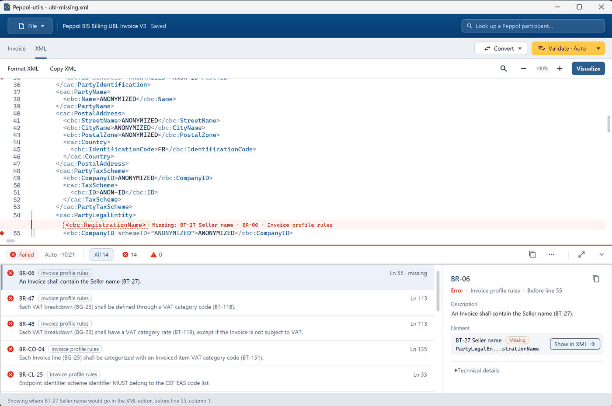

# Peppol-utils 1.9.2 User Guide

Peppol-utils opens an electronic invoice on your computer. You can read it, edit its XML, validate it, convert it between UBL and CII, save it, and look up the buyer's or seller's Peppol registration.

It opens a **Factur-X PDF** (a PDF that carries the invoice XML) or a standalone **`.xml`** invoice in CII or UBL syntax.

## Install

Download the files from the [latest release](https://github.com/Duclevn/Peppol-utils-release/releases/latest).

- **Windows:** run `Peppol-utils-<version>-windows-x64-setup.exe`, then start Peppol-utils from the Start menu. No Java is needed.
- **Any system:** use `peppol-utils-<version>.jar` with Java 25 or newer: `java -jar peppol-utils-<version>.jar`. It runs on Windows x64, Linux x64/ARM64 and macOS Intel/Apple Silicon.

## Open an invoice

Click `Open invoice`, choose `File` > `Open...`, or press `Ctrl+O`. In Windows you can also right-click a `.pdf` or `.xml` file and choose `Open with` > `Peppol-utils`.

Opening an invoice never validates it and never uses the network.

## The window

The row at the top shows your file, its format, `Saved` or `Unsaved`, and the `Convert` and `Validate` buttons. Each file you create with `Convert` is a tab in that row after your file, with a dot while it is unsaved and a `×` to close it. Under the row are two cards, and a third column when the Peppol lookup is open:

- `Overview`: invoice number, type, date, amounts, seller, buyer, and the detected format, profile and validation rules (VESID).
- `Document`: has tabs `Original PDF` (a Factur-X file only), `XML` and `Visualize from XML`. A standalone XML opens on `Visualize from XML`. The PDF and the rendering show all pages in one column: scroll through them, and the arrows jump to the previous or next page. The zoom (`−`, percentage, `+`) is at the right of the tab row; above 100% the page grows past the card and scrolls sideways. On the `XML` tab the same place holds the text size of the XML. When the card is narrow, the page controls fold into `⋯` (`More page controls` for the PDF; for the rendering it also holds `Render again` and `Save PDF as…`). The toolbar of the `XML` tab folds the same way: Find moves into `⋯`.

## The XML tab

The `XML` tab of the Document card holds the invoice XML. Edit it directly, use `Format XML`, search with `Ctrl+F`, or `Copy XML`. Edits stay unsaved until you save (see below), and `Visualize` shows how your edits render.

## Validate

Click `Validate`, or press `F5`. Its arrow picks the rule set:

- `Auto`: the rules for the detected syntax and profile.
- `France CTC`: also checks the France CTC rule sets, and Flux 1 and Flux 10 documents.

For a Factur-X PDF, validation also checks the PDF container and PDF/A-3.

The result appears in the validation line at the bottom: `Passed`, `Passed with warnings` or `Failed`, with the rule set and the time. Click it to open the drawer.

- The drawer is a table with one line per finding: its rule ID, message, element and XML line. With several validation sets (for example France CTC) the findings are grouped under one header per set. The chips `All`, errors and warnings filter the list.
- Select a finding (click it, or use the arrow keys) and the XML tab opens on its line, with a **finding card** under it: the full message, the element, the allowed values when the validator gives them, and `Technical details` (collapsed) for the validator's own data. `F8` and `Shift+F8` go to the next and previous finding, `Enter` moves into the card, and `Esc` closes it. A finding that has no place in the XML opens under its row instead, with a note saying why.
- `Copy report` and `Copy finding` put the text on the clipboard.
- After you edit the XML, the result is marked `Out of date` until you validate again.

### A missing element

When a finding is about a business term that is not in the XML (for example `BT-27 Seller name`), the XML tab shows a **ghost line** where that element belongs: a light red line, outside the text, with the expected start tag and `Missing: BT-27 Seller name · BR-06`. Selecting the finding puts its card under that line. Nothing is added to your XML.

## Convert

The `Convert` menu works on the current XML, including unsaved edits. Each result opens in its own tab; your invoice is not changed.

- `UBL to CII` and `CII to UBL` change the syntax.
- `France CTC Flow 1` generates Flux 1 XML in `Base` or `Full` form. For an ordinary invoice, choose its billing framework (BT-23); the app does not guess it.

An item that cannot run for the open XML is greyed out and says why. In a result tab, use `Format XML`, `Save as...` or `Close tab`.

## Save

Click `Save changes`, or press `Ctrl+S`. The app asks `Replace the original invoice?`; choose to replace it or `Save a copy…`. It makes no backup, so keep your own copy of important invoices.

Saving is strict:

- The XML is validated first with the `Auto` rules. For a PDF, the XML is put back into the PDF and the rewritten PDF is checked again before it replaces the original.
- If the XML has errors, the app lists them and offers `Review findings`, `Save anyway` or `Cancel`. `Save anyway` is possible only when the XML is well-formed and the PDF container stays valid.
- If the file cannot be saved safely, the original is left as it was.

If only the PDF's Factur-X container is invalid, open the drawer and choose `⋯` > `Repair PDF container…`. It writes a separate `-repaired.pdf`.

## Peppol lookup

Check whether a participant is registered on the Peppol network.

- Click `Peppol lookup` beside the Seller or Buyer in the `Overview` card, or type a participant ID such as `0225:123456789` in the top bar's lookup field (`Ctrl+L`).
- The panel checks Production and Test separately and shows the invoice document types the participant publishes and their endpoints, plus the Business Card when there is one.

A result says what was published, not that delivery works. A lookup that fails (no internet, a firewall) is not the same as an unregistered participant: try again. Every lookup queries the network again; nothing is cached.

## Privacy

Invoices are processed on your computer only. The app uses the network only when you start a Peppol lookup, and nothing from the open invoice is sent. The app has no other online feature.

## Shortcuts

| Keys | Action |
| --- | --- |
| `Ctrl+O` / `Ctrl+S` | Open / save |
| `F5` or `Ctrl+Enter` | Validate |
| `Ctrl+F` | Search the XML |
| `Ctrl+L` | Peppol lookup field |
| `Ctrl+=` / `Ctrl+-` / `Ctrl+0` | Larger / smaller / normal interface |
| `Esc` | Cancel the running operation |

## Troubleshooting

- **The jar does not start:** run `java -version`; Peppol-utils needs Java 25 or newer.
- **"The native component of Peppol-utils could not start":** a security policy blocks `Peppol-utils.exe`. Ask your administrator to allow it, reinstall, or use the jar.
- **Save fails:** read the message. Common causes are invalid XML, a file open in another program, or a read-only folder.

## Report a problem

Open an issue at [github.com/Duclevn/Peppol-utils-release/issues](https://github.com/Duclevn/Peppol-utils-release/issues) with your version (`File` > `About Peppol-utils`), what you did and what you saw. Do not attach real customer invoices; use an anonymized copy.
